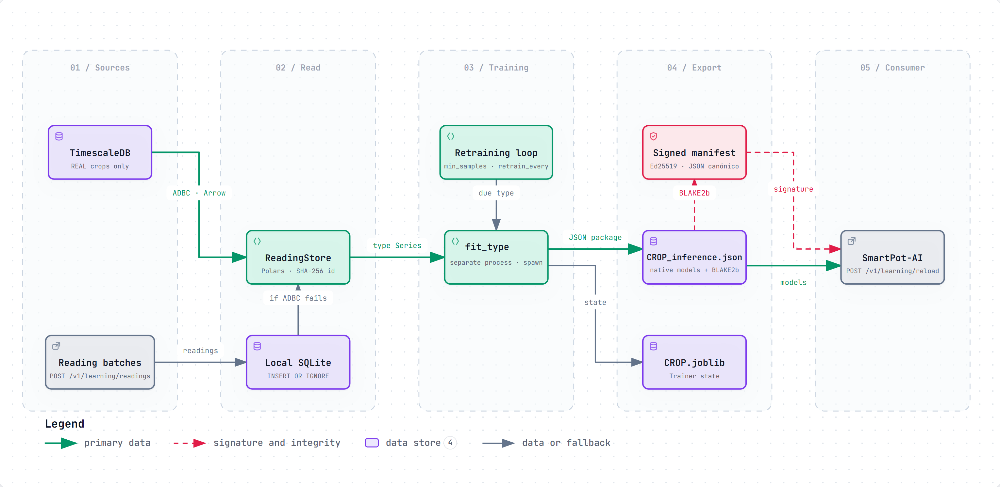
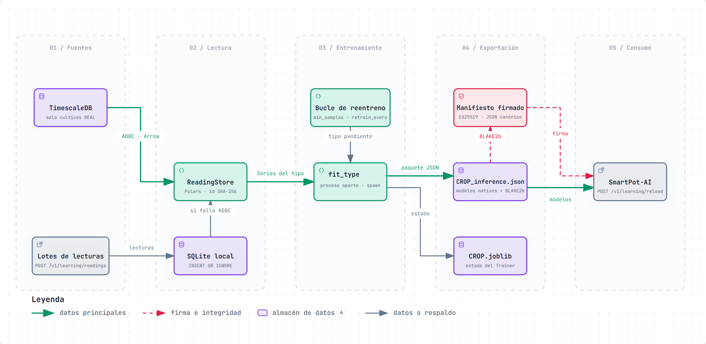

# SmartPot-Trainer · Interactive Diagrams

[English](#english) | [Español](#español)

---

## English

Each diagram is a self-contained HTML page that works offline. Download it and open it in a browser to zoom, search nodes, trace a path and jump to the exact source lines on GitHub. The PNG preview is the light-theme render of the same diagram.

### 1. Trainer Learning Cycle

Where the training data comes from and where the models go. `ReadingStore` reads the latest readings of a crop type from TimescaleDB over ADBC (REAL crops only, crop id replaced by its SHA-256 prefix, local hour computed in SQL) and falls back to the local SQLite store fed by `POST /v1/learning/readings`. The retraining loop picks the types that reached `min_samples` or `retrain_every`, `fit_type` trains them in a separate process, and the exporter writes `CROP_inference.json` with its BLAKE2b hash and an Ed25519-signed manifest that SmartPot-AI verifies when it reloads.

- Interactive: [English](SmartPot_Trainer_A1_Learning_Dataflow.en.html) · [Spanish](SmartPot_Trainer_A1_Learning_Dataflow.es.html)
- Sources: `app/learning/store.py`, `app/learning/service.py`, `app/learning/exporter.py` and `app/routers/learning.py` at commit `172eff2`.

---

## Español

Cada diagrama es una página HTML autocontenida que funciona sin conexión. Descárgala y ábrela en un navegador para ampliar, buscar nodos, seguir un recorrido y saltar a las líneas exactas del código en GitHub. La vista previa PNG es el mismo diagrama en tema claro.

### 1. Ciclo de aprendizaje del Trainer

De dónde salen los datos de entrenamiento y adónde van los modelos. `ReadingStore` lee las lecturas más recientes de un tipo de cultivo desde TimescaleDB por ADBC (solo cultivos REAL, id del cultivo reemplazado por su prefijo SHA-256 y hora local calculada en SQL) y, si falla, usa el SQLite local que alimenta `POST /v1/learning/readings`. El bucle de reentreno escoge los tipos que alcanzaron `min_samples` o `retrain_every`, `fit_type` los entrena en un proceso aparte y el exportador escribe `CROP_inference.json` con su hash BLAKE2b y un manifiesto firmado con Ed25519 que SmartPot-AI verifica al recargar.

- Interactivo: [inglés](SmartPot_Trainer_A1_Learning_Dataflow.en.html) · [español](SmartPot_Trainer_A1_Learning_Dataflow.es.html)
- Fuentes: `app/learning/store.py`, `app/learning/service.py`, `app/learning/exporter.py` y `app/routers/learning.py` en el commit `172eff2`.

